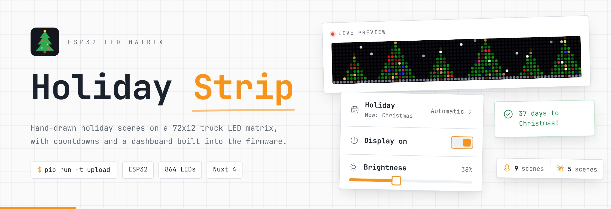

<div align="center">

<picture>
    <source media="(prefers-color-scheme: dark)" srcset="docs/images/banner-dark.webp">
    
</picture>

# 🎄 Holiday Strip

### An ESP32-powered holiday show for a 72x12 LED matrix

Holiday Strip turns a 72x12 truck LED matrix into an animated holiday display: hand-drawn scenes for Christmas and New Year's Eve, your own scrolling messages, and countdowns to both. It follows the calendar by itself, and a phone-friendly dashboard built into the firmware controls it all.

<p>
  
  
  
  
  
  
</p>

<p>
	<a href="#overview"><strong>Overview</strong></a> •
	<a href="#quick-start"><strong>Quick Start</strong></a> •
	<a href="#hardware"><strong>Hardware</strong></a> •
	<a href="#development"><strong>Development</strong></a> •
	<a href="#troubleshooting"><strong>Troubleshooting</strong></a> •
	<a href="#license"><strong>License</strong></a>
</p>

</div>

<a id="overview"></a>
## 📘 Overview

The matrix came from a truck sign; its protocol is in [docs/protocol.md](docs/protocol.md). The strip plays the scenes of one holiday at a time, rotating every 20 seconds with a crossfade:

- 🎄 **Christmas**: Greeting, Snowfall, Christmas trees, Santa's sleigh, Fireplace, Fairy lights, Gifts, Candy cane, and Countdown to Christmas (the days left, all year).
- 🎆 **New Year's Eve**: Countdown (to midnight on December 31, then the new year bursting in), Confetti, Fireworks, Champagne and Sparklers.
- 💬 **Custom message**: just your text, in the color you pick, on any day.

On **Automatic**, the calendar picks the holiday (New Year's Eve from December 27 to January 1, Christmas the rest of the year), and in the last minute of the year the strip jumps to the countdown. You can also pin a holiday or a single scene.

The dashboard has three tabs, like every OpenGizmo app:

- **Strip**: live preview, on/off and brightness, the holiday and, under it, its scene and custom message (and the text color of the custom message), then the power limit.
- **Device**: the device card of [gizmo-common](https://github.com/open-gizmo/gizmo-common): info, network, restart.
- **WiFi**: change the network.

The language (English or Italian) is picked in the top bar. The texts on the matrix follow it: the Christmas countdown, and the greetings you haven't changed.

Also: Wi-Fi setup from your phone through a hotspot, settings saved in flash, a per-frame power limiter, and a factory reset (hold BOOT for 10 seconds).

<a id="quick-start"></a>
## 🚀 Quick Start

You need an ESP32 DevKit (ESP-WROOM-32), the matrix, a 5 V power supply, PlatformIO, and Node.js 24.21 or newer.

1. Build the dashboard, which is embedded in the firmware. Run this again whenever the web app changes:

```bash
cd webapp && npm ci && npm run build:embedded
```

2. Build and upload the firmware over USB:

```bash
cd microcontroller && pio run --target upload
```

3. On the first boot, join the `Holiday-Strip` hotspot with your phone and pick your network.
4. Open `http://holiday-strip.local/`, or the board's IP address.

<a id="hardware"></a>
## 🔌 Hardware

- **Data:** GPIO16 (`16` or `RX2` on most DevKits), into the left edge of the matrix.
- **Ground:** connect a GND pin of the DevKit to the ground of the matrix's supply.
- **Power:** never power the matrix through the DevKit.
- **Antenna:** it's the end of the WROOM module, past the metal can. Keep it away from metal.
- **Matrix:** 864 WS2812B-compatible LEDs in one chain, GRB, 800 kHz; the top half is the bottom half rotated 180°.

**Power limit:** at full white, the matrix can draw about 50 A. The firmware estimates every frame's current and dims it to stay under the power limit (3000 mA by default, 1000 to 8000 mA on the dashboard). Set it to about 80% of what your supply delivers. With a supply under 10 A, also lower `MAX_MAX_MILLIAMPS` in [config.cpp](microcontroller/src/config/config.cpp).

<a id="development"></a>
## 🛠️ Development

**Firmware** (`microcontroller/src/`):

| Folder | What it does |
| --- | --- |
| `display/` | LED chain mapping, gamma, power limiter, RMT output |
| `scenes/` | One file per scene, and the holidays with their scenes (`scenes.cpp`) |
| `player/` | Follows the holiday, rotates and crossfades its scenes |
| `calendar/` | Holiday of the date, Christmas countdown, New Year's midnight |
| `settings/` | Saved settings (NVS), and the checks of the dashboard's JSON |
| `server/` | The dashboard and its API, one file per endpoint |
| `config/` | Pins, timings, power figures, defaults, languages |

The Wi-Fi setup and the device API come from gizmo-common.

**API** (`{ errorId, errorMessage, data }`, only for the dashboard's own page):
- `GET /api/state`: the settings and the holidays with their scenes.
- `POST /api/settings`: changes any of the settings.
- `GET /api/frame`: the frame on the matrix, for the live preview.

**Dashboard** (`webapp/`): a Nuxt 4 app on the gizmo-common layer. `npm run dev` runs it against a mock of the strip, no board needed.

**Build profiles:**
- `release`: the default.
- `debug`: with the serial log; open it with `pio device monitor`.
- `native`: the host tests.

**Tests**, no board needed:

```bash
cd microcontroller && pio test -e native
```

```bash
cd webapp && npm test
```

**Scene videos:** `tools/scene_video/render.sh` records any scene to an MP4 with the real scene code (needs `g++` and `ffmpeg`). The arguments are the holiday and scene indexes, the seconds, the output file, and optionally the clock. For example, the New Year's countdown from 13 seconds before midnight:

```bash
microcontroller/tools/scene_video/render.sh 1 0 24 countdown.mp4 2026-12-31T23:59:47
```

`MATRIX_LANGUAGE=en` records the texts in English, and `MESSAGE_COLOR=0` to `6` sets the custom message color.

**README banner:** `tools/banner/make_banner.sh` draws `docs/images/banner-*.webp` again, with a real frame of the matrix (needs Playwright and `webapp/node_modules`).

**Releasing:** versions follow [semver](https://semver.org) in `VERSION`.
1. On `feature`, set the version in `VERSION` and in `webapp/` (`npm version X.Y.Z --no-git-tag-version`).
2. Bring it through `develop` to `main`.
3. Run the **Release 📦** workflow on `main` (Actions > Release > Run workflow). It checks the version, runs the tests, and creates the GitHub release.

<a id="troubleshooting"></a>
## 🧰 Troubleshooting

- **Nothing lights up:** check the data wire on GPIO16, and the shared ground.
- **Wrong colors or flicker:** keep the data wire short, or add a 3.3 V to 5 V level shifter.
- **Dim with bright scenes:** that's the power limiter. Raise the limit only if your supply can take it.
- **No hotspot:** it only opens when no saved network works. Flash `debug` and check the serial log.
- **`holiday-strip.local` doesn't open:** use the board's IP address (it's in the `debug` log).
- **The dashboard is out of date:** run `npm run build:embedded` before building the firmware.
- **Dots instead of numbers in the countdowns:** the clock comes from NTP, so wait until the board is online.

<a id="license"></a>
## 📄 License

MIT. See [LICENSE](LICENSE).
